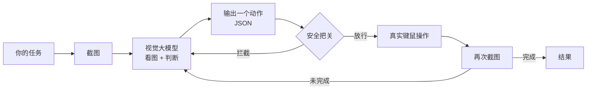

# PawPilot

**让大模型真正动手：用自然语言操控你的键盘和鼠标。**

你说一句话，它自己看屏幕、找按钮、点击、输入、滚动，直到把事情做完。

```bash
pawpilot "打开资源管理器，在 D 盘新建一个叫 重要资料 的文件夹"
```

终端里你会看到它每一步在想什么、点了哪里：

```
第 1 步 [点]    单击 (62, 34)
   想: 屏幕左下角有 Windows 开始按钮，先点开它。        (1.4s  1842 tok)
第 2 步 [输入]  输入 "资源管理器"
   想: 搜索框已经激活，直接键入。
第 3 步 [按键]  按下 enter
   想: 搜索结果第一条就是文件资源管理器。
第 4 步 [组合键] CTRL + N
   想: 已打开新窗口，接下来在地址栏导航到 D 盘。
...
╭─────────────────────────────────────────────────╮
│ 任务完成  已在 D 盘创建 "重要资料" 文件夹          │
│ 共 9 步 | 耗时 34.2s | prompt token 累计约 12680  │
╰─────────────────────────────────────────────────╯
```

---

## 为什么还需要一个

市面上做 GUI 自动化的不少，但大多是这样：

- **脚本式**（Selenium / Playwright / AutoHotkey）：要写代码、写选择器，换个界面就失效。PawPilot 不需要 —— 它看的就是像素，跟人眼看到的一致。**任何有图形界面的软件它都能用，包括那些没有 API 的老旧桌面程序。**
- **黑盒服务**：把屏幕传到你不知道的服务器上，用我也不清楚的模型。PawPilot 是你自己装的 Python 包，代码全在这里，API Key 是你自己的，流量去哪儿你自己查得到。

它和 Open Interpreter 那一类的区别在于：**这个项目的注意力全在图形界面上**。不带 Python 沙箱执行、不碰终端 —— 专注于把"看屏幕 → 决定动作 → 操作键鼠"这一件事做好，顺带把安全和中文输入这些细节填上。

## 快速开始

需要 **Python 3.9+**，本机需要有图形界面。

```bash
git clone https://github.com/blank572/pawpilot.git
cd pawpilot
pip install -e .
```

申请一个 Key。推荐从 **智谱** 起步：`GLM-4V-Flash` 是**免费**的视觉模型，注册就有，跑通整个流程完全够用。

```bash
# Windows PowerShell
$env:ZHIPUAI_API_KEY = "你的key"

# macOS / Linux
export ZHIPUAI_API_KEY="你的key"
```

然后：

```bash
pawpilot "打开计算器，算一下 1234 乘以 5678"
```

第一次运行强烈建议加上 `--confirm`，它会每步都问过你再执行：

```bash
pawpilot --confirm "把我桌面上所有 .txt 文件挪到 文档\归档 里"
```

> 也可以在项目根目录创建 `.env` 文件写 Key，参照 `.env.example`。

## 支持的模型

| provider | 默认模型 | Key 环境变量 | 备注 |
|---|---|---|---|
| `zhipu` | `glm-4v-flash` | `ZHIPUAI_API_KEY` | **推荐起步**，有免费额度 |
| `qwen` | `qwen-vl-max-latest` | `DASHSCOPE_API_KEY` | 阿里云百炼 |
| `stepfun` | `step-1v-8k` | `STEPFUN_API_KEY` | 阶跃星辰 |
| `siliconflow` | `Qwen/Qwen2.5-VL-72B-Instruct` | `SILICONFLOW_API_KEY` | 聚合多家开源模型 |
| `openai` | `gpt-4o` | `OPENAI_API_KEY` | |
| `ollama` | `qwen2.5vl:7b` | 无需 | 本地跑，**数据不出本机** |

切换只是一行：

```bash
pawpilot --provider qwen "..."
pawpilot --provider siliconflow --model Qwen/Qwen2.5-VL-72B-Instruct "..."
pawpilot --provider openai --base-url https://api.openai.com/v1 "..."
```

凡是兼容 OpenAI `chat/completions` 协议的端点都能接，加自定义也很容易（见下文"接别的模型"）。

`pawpilot --list-providers` 能看到完整的清单和申请地址。

## 它是怎么跑起来的



一次循环 = 一张截图 + 一次模型调用 + 一个动作。**刻意不做多步批量规划**：每执行一步界面就可能变化，提前规划出来的第二第三步多半已经失效了，看起来聪明实际更慢更贵。

模型输出的是归一化的 `0~999` 画布坐标，而不是绝对像素。原因是每家模型内部都会把图 resize 到自己的输入尺寸，让它输出绝对像素，等于逼它猜自己看到的图有多大 —— 误差肉眼可见。归一化坐标则跟 resize 无关。

## 安全

这个项目在替你按鼠标。以下是已经做好的，**请读一遍**：

- **物理急停**：任何时候把鼠标甩到屏幕左上角，立刻中断。这是最可靠的保险，不需要记住任何命令。
- **危险指令拦截**：`rm -rf /`、`format`、`del /f`、`DROP DATABASE`、`git push --force`、`curl | bash` 等会被识别并拦下。
- **危险组合键拦截**：`Win+R`、`Ctrl+Alt+Del`、`Alt+F4` 等。
- **逐步确认**：`--confirm`，每一步都要你点头。
- **步数与失败熔断**：默认上限 25 步；连续 3 次出错自动停止，不会无限烧钱。
- **密码不落盘**：需要 AI 代填密码时用 `PAWPILOT_SECRET` 环境变量，模型只知道占位符 `<secret>`，真实值既不进 API 请求也不进日志。

`--allow-risky` 可以关掉全部拦截。**关掉之前想清楚。**

另外几条建议：运行前保存好正在编辑的文档；处理重要数据时先 `--confirm` 跑一遍观察它的行为；不要在登录着银行账户的机器上跑未经确认的任务。

## 一些设计上的取舍

这部分是给想读懂代码的人看的。

**中文输入**。`pyautogui.typewrite` 走的是键盘事件模拟，只能处理 ASCII，遇到中文会静默丢字符 —— 这是个很容易踩的坑。所以非 ASCII 文本一律改走剪贴板粘贴。`core/_clipboard.py` 手写了三个平台的实现，没引入 `pyperclip`，少一个依赖少一层失败可能。

**DPI 缩放**。Windows 上如果进程不是 DPI-aware，系统会给它一套"虚拟"坐标，而截图拿到的是物理像素，两者差一个 1.25 / 1.5 / 2 的系数。表现就是"AI 明明说点这儿，实际点到了隔壁"。启动时我们会把自己提升为 Per-Monitor DPI Aware，让两边坐标系严格对齐。

**上下文体积**。每轮带图，十几轮下来 token 就爆炸了。`_trim_history_images()` 只保留最近 3 轮的截图，更早的退化成纯文字 —— 模型依然知道"我点过哪里"，但省下了大量开销。

**屏幕无变化检测**。AI 点了一下，界面纹丝不动；人会立刻换办法，模型却容易在同一个坐标上反复点。我们比较前后帧的灰度直方图差异，检测不到变化时明确告诉它"刚才那下没生效，换个方式"。

**容错解析**。模型输出很难看：可能裹着 markdown 代码块、前后各加一句废话、甚至把 `action` 这一层省掉。`extract_json()` 和 `split_thought_action()` 负责把这些都捞回来，实在捞不出来才重试。实测能覆盖绝大多数常见变形。

**危险动作先警告，不直接终止**。一刀切太粗暴 —— 拦下的很可能是误判（比如它只是想删个临时文件）。默认把"这个动作被拦截了，换种方式"反馈给模型让它重试，但连续尝试达到 3 次就果断停止。

## 命令行参数

| 参数 | 说明 |
|---|---|
| `--provider, -p` | 服务商，见上表 |
| `--model, -m` | 覆盖默认模型 |
| `--base-url` | 自定义 API 端点 |
| `--confirm, -c` | **每步确认后再执行** |
| `--allow-risky` | 关闭危险拦截（慎用） |
| `--record, -r` | 保存每一步截图到 `runs/` |
| `--monitor` | 操作第几个显示器，默认 1（主屏） |
| `--max-steps` | 步数上限，默认 25 |
| `--step-delay` | 每步后等待秒数，默认 1.0 |
| `--quiet, -q` | 只输出最终结果 |
| `--list-providers` | 列出服务商 |
| `--list-monitors` | 列出显示器 |
| `--check` | 只检查配置是否就绪 |

## 当作库来用

```python
from pawpilot import ComputerAgent, Config

cfg = Config.from_env(provider="zhipu", max_steps=20, record=True)
agent = ComputerAgent(cfg)
result = agent.run("打开记事本，写一句自我介绍")

print(result.reason)     # StopReason.DONE
print(result.message)    # 模型给出的最终状态描述
for step in result.steps:
    print(step.index, step.describe, step.thought)
```

`ComputerAgent` 接受 `on_step` 和 `on_ask` 两个回调，可以接自己的 UI（参见 `pawpilot/cli.py` 里 `TerminalIO` 的实现）。

**接别的模型**：继承 `pawpilot.models.base.VisionModel`，实现唯一的 `predict(messages) -> Turn` 方法，然后在 `models/factory.py` 里加个分支。上层代码完全不用动。

## 项目结构

```
pawpilot/
├── pawpilot/
│   ├── cli.py                 命令行入口与终端渲染
│   ├── config.py              配置与服务商预设
│   ├── core/
│   │   ├── agent.py           主循环（观察→思考→行动）
│   │   ├── screen.py          截图、DPI、坐标换算
│   │   ├── actions.py         动作定义、解析、执行
│   │   ├── safety.py          安全熔断
│   │   └── prompts.py         提示词
│   └── models/
│       ├── base.py            模型抽象与容错 JSON 提取
│       ├── openai_compat.py   OpenAI 协议实现
│       └── factory.py         构造模型
├── examples/
├── pyproject.toml
└── README.md
```

## 目前的局限

诚实说明，免得踩坑：

- **精度受限于模型**。视觉定位不是百分百准，尤其是密集的小图标和相似控件。GLM-4V-Flash 免费但精度一般；要稳定还得上更强的付费模型。
- **不适合高实时场景**。一次循环通常要 1~3 秒，别指望它打游戏。
- **多显示器**：目前一次操作一个屏，用 `--monitor` 指定。跨屏拖拽不支持。
- **主要在 Windows 上验证过**。macOS / Linux 的代码路径写了，但缺少充分的实机测试 —— 欢迎提 issue 或 PR。
- **没有 OCR 辅助**。纯靠视觉模型读文字，小字号文本偶尔认不准。

## Roadmap

- [ ] **Set-of-Mark**：先给屏幕上的可交互元素打上编号，让模型说"点 12 号"而不是给坐标，能显著提升点击准确率
- [ ] OCR 辅助定位小字号文本
- [ ] 任务模板与宏录制：把一次成功的操作过程存成可复用的脚本
- [ ]  macOS / Linux 实机完善测试
- [ ] 截图差分压缩，进一步降低 token 消耗
- [ ] 网页版运行日志回放

## 许可证

MIT
